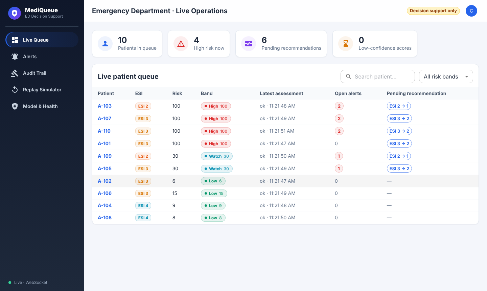
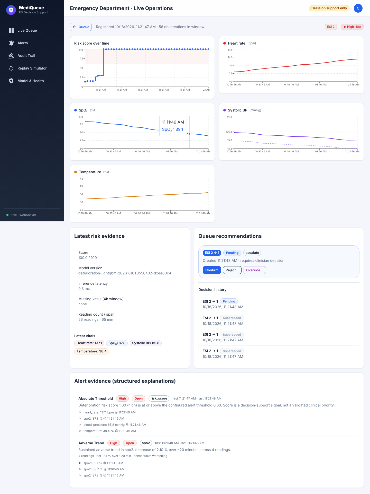
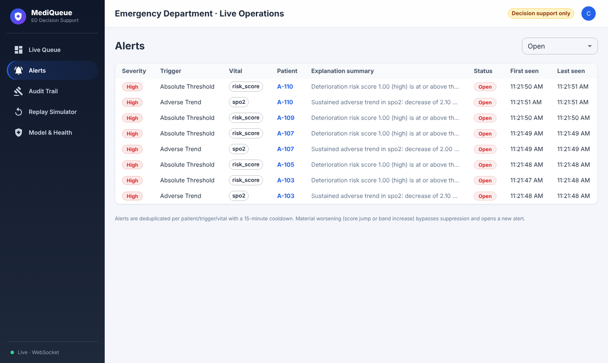
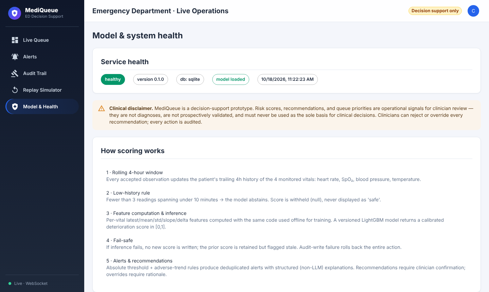

# MediQueue

**AI-powered real-time early-warning system for emergency-department patient
deterioration and dynamic triage — clinician decision support, not autonomous
clinical decision-making.**

MediQueue continuously monitors a rolling 4-hour history of four vitals
(heart rate, SpO₂, blood pressure, temperature), scores deterioration risk
with a versioned LightGBM model, raises deduplicated alerts with structured
explanations, and proposes queue-priority recommendations that clinicians
must confirm, reject, or override. Every action is fully audited.

> **Clinical disclaimer.** This is a research/teaching prototype. Risk scores
> and recommendations are operational signals for clinician review. They are
> not diagnoses, are not prospectively validated on the target population,
> and must never be the sole basis for clinical decisions.



<details><summary>More screenshots</summary>





</details>

## Quick start

```bash
# 1. Python 3.11+ environment
python3 -m venv .venv && .venv/bin/pip install -r requirements.txt

# 2. Train the demo model on the synthetic corpus (demonstration evidence only)
.venv/bin/python scripts/train_model.py --task deterioration --dataset synthetic --n-patients 400

# 3. Build the dashboard
cd frontend && npm install && npm run build && cd ..

# 4. Run
./scripts/run_dev.sh            # API + dashboard on http://127.0.0.1:8000
# API docs: http://127.0.0.1:8000/docs
```

Or with Docker (API + PostgreSQL): copy `.env.example` to `.env`, then `docker compose up --build`.

### Demo accounts

| Username    | Password          | Role          |
| ----------- | ----------------- | ------------- |
| `clinician1`| `clinician1-pass` | Clinician     |
| `admin`     | `admin-pass`      | Administrator |
| `auditor1`  | `auditor-pass`    | Auditor       |

## Architecture (one paragraph)

A FastAPI service owns the whole pipeline in a **single database
transaction** per observation: validation → history window (4 h rolling) →
feature computation (identical code offline/online) → model inference →
risk banding → alert rules (absolute threshold + adverse trend, deduplicated
with cooldown and material-worsening bypass) → structured explanations →
queue recommendations → audit write. If the audit write fails, the entire
action rolls back and the client sees a failure — no silent half-commits.
Live updates are delivered over WebSocket with a durable `events` table and
polling fallback. A synthetic replay simulator drives the same ingestion
pipeline for demos and benchmarks.

```
HL7-style feed ──▶ API ──▶ Pipeline (one tx) ──▶ SQLite/PostgreSQL
                          │        │
                          │        ├──▶ events (durable) ──▶ WebSocket ──▶ Dashboard
                          │        └──▶ audit_events (append-only trigger)
                          └──▶ React dashboard (queue, patient detail, alerts, audit, replay)
```

See [`docs/architecture.md`](docs/architecture.md) for the full design.

## Repository layout

```
backend/mediqueue/       FastAPI app, pipeline, modules (validation, history,
                         features, inference, risk, recommendation, audit,
                         simulator), realtime hub, training package
backend/tests/           51 pytest tests (unit + API integration)
frontend/                React 19 + MUI dashboard (Vitest tests; `npm run build` →
                         frontend/dist, served by the API)
backend/migrations/      Alembic schema migrations (`alembic upgrade head`)
scripts/                 train_model.py, evaluate_model.py, benchmark.py,
                         run_dev.sh
artifacts/               Versioned model artifacts + evaluation reports
docs/                    Architecture, IBM Z deployment, datasets, security
```

## Key behaviors

- **4 vitals** — heart rate, SpO₂, blood pressure, temperature only.
- **4-hour rolling window** per patient; features computed per vital
  (latest, mean, std, min, max, slope, short-horizon delta, abrupt change)
  plus cross-vital shock index.
- **Low-history rule** — fewer than 3 readings spanning < 10 minutes:
  the model abstains; score is `null` and **never** displayed as "safe".
- **Fail-safe scoring** — inference failure writes no new score; the prior
  score is retained and marked **stale**.
- **Alerts** — absolute risk threshold + adverse-trend rules. Deduplicated
  on `(patient, trigger_type, triggering_vital)` with a 15-minute cooldown;
  material worsening (+0.15 score or band increase) bypasses suppression.
  Explanations are **structured templates only — no LLM** in the
  clinical-pathway.
- **Recommendations** — pending until a clinician confirms; at most one ESI
  triage-category step per confirmed action (1 = most urgent); reject and
  override both require a rationale; everything is audited.
- **Audit** — append-only (SQLite triggers; DBA-managed on PostgreSQL/Db2).
  Risk-scoring actions persist the audit row in the **same transaction** as
  the action; audit-write failure rolls the action back (HTTP 500).
- **Replay simulator** — synthetic patient timelines injected through the
  exact same ingestion path (not a shortcut), for demos and load tests.

## Training & evaluation

```bash
# Synthetic corpus (system evidence only — not clinical evidence)
.venv/bin/python scripts/train_model.py --dataset synthetic --n-patients 600

# PhysioNet/CinC 2019 (sepsis task; download under its license first)
.venv/bin/python scripts/train_model.py --task sepsis --dataset physionet \
  --data-dir /path/to/training_setA

# Evaluate a versioned artifact
.venv/bin/python scripts/evaluate_model.py artifacts/models/<version-dir>
```

- Patient-level 70/15/15 train/validation/test split (no patient leakage).
- Class-weighted loss (no SMOTE — synthetic minority trajectories may be
  implausible).
- Metrics: AUROC, AUPRC, precision/recall/F1 at the operating threshold, plus calibration (Brier, ECE) and a fixed-threshold operating-point table.
- Probabilities are isotonic-calibrated on the validation split; the operating threshold is the highest one reaching 0.80 validation recall (`--target-recall`).
- Every artifact is versioned with `dataset_hash` + `feature_schema_hash`;
  the serving path refuses artifacts whose feature schema does not match.
- Sepsis labels and general-deterioration proxy labels are **never blended**
  into one model or one report.

### Results (synthetic data only)

| Metric | Value |
| --- | --- |
| AUROC / AUPRC | 0.822 / 0.706 |
| Recall / precision at operating threshold 0.17 | 0.821 / 0.430 |
| Brier / ECE (isotonic-calibrated) | 0.109 / 0.038 |

These are system-demonstration numbers on a synthetic corpus, not clinical evidence. See the [model card](docs/model-card.md) for intended use and limitations, including the alert-threshold mismatch.

## Benchmark

```bash
./scripts/run_dev.sh   # in another terminal
.venv/bin/python scripts/benchmark.py --patients 30 --minutes 10 --concurrency 8
```

Reports client-observed latency for ingest → persisted score and
event → visible alert, plus server-side stage timings.

## Configuration

All thresholds are environment-overridable (`MEDIQUEUE_*`); see
`backend/mediqueue/config.py` for the full list. Highlights:

| Variable | Default | Meaning |
| --- | --- | --- |
| `MEDIQUEUE_DATABASE_URL` | `sqlite:///./mediqueue.db` | Any SQLAlchemy URL (PostgreSQL-ready) |
| `MEDIQUEUE_SECRET_KEY` | dev-only literal | HMAC key for tokens — **must** be set in deployment |
| `MEDIQUEUE_ENV`                         | `dev`                      | `production` enforces a strong secret, explicit CORS, no demo users |
| `MEDIQUEUE_CORS_ORIGINS`                | `*`                        | Comma-separated allowed origins (explicit in production) |
| `MEDIQUEUE_SEED_USERS`                  | on in dev, off in prod     | Create demo accounts; use `scripts/create_user.py` instead |
| `MEDIQUEUE_LOGIN_MAX_ATTEMPTS`          | `5` per `300` s            | Failed-login throttle (HTTP 429)                    |
| `MEDIQUEUE_ALERT_THRESHOLD` | `0.60` | Absolute-risk alert threshold |
| `MEDIQUEUE_MATERIAL_WORSENING_DELTA` | `0.15` | Score jump that bypasses cooldown |
| `MEDIQUEUE_MIN_BAND_FOR_RECOMMENDATION` | `elevated` | Minimum alert band that produces a recommendation |
| `MEDIQUEUE_MAX_PRIORITY_STEP` | `1` | Max ESI steps per confirmed action |
| `MEDIQUEUE_MODEL_VERSION` | latest on disk | Pinned model artifact |

## Documentation

- [Architecture](docs/architecture.md) — modules, data flow, decisions
- [IBM Z deployment](docs/ibm-z-deployment.md) — running on Linux on IBM Z
- [Datasets](docs/datasets.md) — supported datasets, licenses, formats
- [Security](docs/security.md) — authn/authz, audit, threat notes

## License

Apache-2.0. Public/physiological datasets are **not** redistributed here —
download them under their own licenses (see [docs/datasets.md](docs/datasets.md)).
